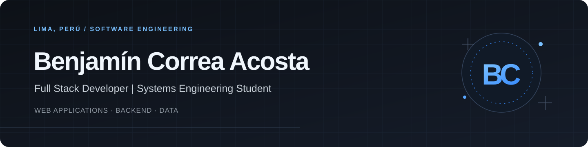
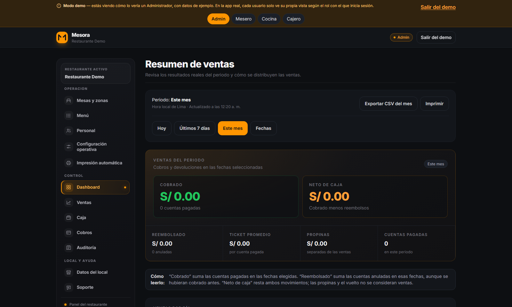

  

  <strong>Estudiante de Ingeniería de Sistemas e Informática en la Universidad Tecnológica del Perú</strong> 
  Lima, Perú · Disponible para prácticas profesionales y oportunidades junior en desarrollo de software.

## Stack tecnológico

<table>
  <tbody>
    <tr>
      <td><strong>Backend</strong></td>
      <td> Java &nbsp;  Spring Boot &nbsp;  Python &nbsp;  Flask &nbsp;  FastAPI</td>
    </tr>
    <tr>
      <td><strong>Frontend</strong></td>
      <td> React &nbsp;  Angular &nbsp;  TypeScript &nbsp;  JavaScript</td>
    </tr>
    <tr>
      <td><strong>Datos</strong></td>
      <td> PostgreSQL &nbsp;  MySQL &nbsp;  SQL Server &nbsp;  Supabase</td>
    </tr>
    <tr>
      <td><strong>Herramientas</strong></td>
      <td> Git &nbsp;  GitHub &nbsp;  Docker &nbsp;  Swagger  Playwright &nbsp;  Vercel</td>
    </tr>
  </tbody>
</table>

## Proyecto principal · Mesora 1.0

**Mesora** es una plataforma SaaS multi-restaurante que conecta pedidos, mesas, Cocina, Barra, caja, reportes, auditoría e impresión de comandas en un solo flujo operativo. La versión 1.0 está desplegada y preparada para validación controlada con usuarios de prueba.

  

<em>Vista real del dashboard administrativo en el demo público de Mesora; el modo demo usa datos de ejemplo.</em>

**Arquitectura y capacidades**

- Aislamiento multi-restaurante aplicado en PostgreSQL mediante **Row Level Security (RLS)**.
- **Supabase Auth** y permisos definidos por roles para administración, meseros, caja y estaciones de preparación.
- Gestión de mesas, pedidos y comandas; flujos separados para Cocina y Barra.
- Caja por turnos, cobros, arqueo y cierre; reportes con filtros y exportación CSV.
- Auditoría de acciones sensibles y soporte entre restaurantes.
- Impresión manual desde el navegador e impresión automática opcional mediante agente local para Windows.
- Verificaciones automatizadas para TypeScript, build, SQL y flujos de navegador/responsive con **Playwright**.

**Enlaces:** [Repositorio](https://github.com/Benchi2312/Mesora) · [Producción](https://mesora-sistema.vercel.app) · [Demo interactivo](https://mesora-sistema.vercel.app/demo) · [Documentación](https://github.com/Benchi2312/Mesora/tree/main/docs) · [Manual de usuario](https://github.com/Benchi2312/Mesora/blob/main/docs/MANUAL_USUARIO_V1.md)

## Otros proyectos

<table>
  <tbody>
    <tr>
      <td>
        <strong><a href="https://github.com/Benchi2312/SmartParking-Backend">SmartParking</a></strong> 
        Sistema de estacionamiento con autenticación JWT, roles, vehículos, espacios y reservas. Backend en Java/Spring Boot y frontend en Angular. 
        <a href="https://github.com/Benchi2312/SmartParking-Backend">Backend</a> · <a href="https://github.com/Benchi2312/SmartParking-Frontend">Frontend</a> · <a href="https://smart-parking-frontend-three.vercel.app">Demo</a>
      </td>
    </tr>
    <tr>
      <td>
        <strong><a href="https://github.com/Benchi2312/controlpack-frontend">ControlPack</a></strong> 
        Sistema de producción y empaque industrial con órdenes, inventario y reportes. React, Flask y PostgreSQL. 
        <a href="https://github.com/Benchi2312/controlpack-frontend">Frontend</a> · <a href="https://github.com/Benchi2312/controlpack-backend">Backend</a> · <a href="https://controlpack-frontend.vercel.app">Demo</a>
      </td>
    </tr>
    <tr>
      <td>
        <strong><a href="https://github.com/Benchi2312/dadtvplay-pilot">DadTvPlay · piloto</a></strong> 
        Agente de atención por WhatsApp con API en FastAPI y clasificación de intención mediante machine learning (scikit-learn); integra Supabase para datos y estado de conversación. 
        <a href="https://github.com/Benchi2312/dadtvplay-pilot">Repositorio</a>
      </td>
    </tr>
  </tbody>
</table>

## Formación y certificaciones

- **Ingeniería de Sistemas e Informática**, [Universidad Tecnológica del Perú (UTP)](https://www.utp.edu.pe/) · en curso.
- **AI Literacy** · IBM SkillsBuild.
- **Cyber Threat Management**, **Network Defense** y **Endpoint Security** · Cisco Networking Academy.
- [Ver credenciales publicadas](https://pe.linkedin.com/in/benjamin-correa-acosta-a4412a409).

## Contacto

[GitHub](https://github.com/Benchi2312) · [LinkedIn](https://pe.linkedin.com/in/benjamin-correa-acosta-a4412a409) · Lima, Perú